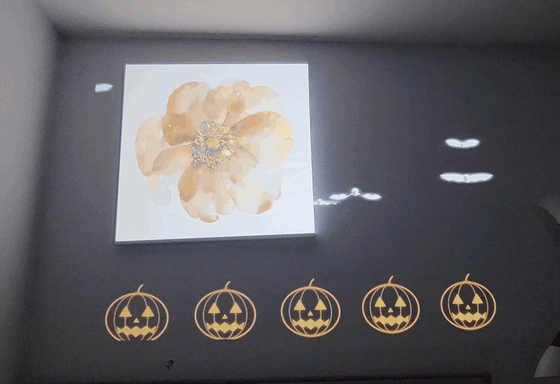

# Projection Mapper

**Free, open-source projection mapping software that runs in your browser.** Works with any
projector: plug it into a Mac, Windows or Linux laptop, drag zones onto the real surfaces in a
room (paintings, pillars, boxes, a window) and fill each one with a glowing effect, a video, a
Lottie animation or a YouTube clip.

No install, no build step, no account: it's a web page. **[Try it in your browser](https://atul016.github.io/projection-mapper/)**,
or download it to use offline.

Made for home projection mapping: Diwali and Halloween decorations, parties, wall art,
shop windows and small stages. A simple, free alternative to paid projection mapping tools
like MadMapper or Resolume Arena when all you need is a few warped zones on a wall.

A real wall and projector. Pumpkins and bats are built-in effects; the clip on the painting is
"5 HOURS Zombie Live 4K Wallpaper" by GODSPEED on YouTube, played through a YouTube zone.

## Features

- **Corner-pin mapping:** drag each zone's four corners onto a surface; it warps to fit.
- **Traced shapes:** trace any outline on the wall (a flower, an arched window, a mirror) and the zone
  is cut to it. Freehand or point by point, several pieces per zone, and holes. `trace` runs round the outline.
- **Built-in effects**, drawn live:
  - Diwali: `diya` (oil lamp), `anar` (fountain firework), `fireworks`, `shower` (falling glitter)
  - Halloween: `pumpkin` (flickering jack-o'-lantern), `ghosts`, `bats`, `eyes` (blinking in the dark)
  - Christmas: `snow`, `tree` (twinkling baubles and a star), `lights` (fairy lights)
  - Any time: `trace` (neon light running round the edges), `pulse` (colour wash), `grid` (for lining things up)
- **Your own content** per zone: a video, GIF or image file, a [Lottie](https://lottiefiles.com)
  `.json` animation, or a link to a YouTube video, a video file or a GIF.
- **Add, duplicate, copy/paste and delete zones** as you go.
- **Remembers everything** in the browser, and **exports / imports** a whole setup as a file to
  back it up or share it.
- **Works offline** (except YouTube), and over Chromecast if you don't have a cable.

## Quick start

1. [Download the ZIP](../../archive/refs/heads/main.zip) (or clone this repo) and unzip it.
2. Connect your projector as a second display (**extended**, not mirrored).
3. Start it:

   | Mac | Windows | Linux |
   |---|---|---|
   | double-click `start-mac.command` | double-click `start-windows.bat` | run `./start.sh` |

   These run a tiny local web server (needs Python 3) and open the page in your browser.
   No Python? Just open `index.html` in your browser. Everything works except YouTube zones,
   because YouTube refuses to play inside pages opened as files.
4. Drag the browser window onto the projector, click the page, and press **F** for fullscreen.

Chrome or Edge recommended. On a Mac, the first time you may need to right-click
`start-mac.command` → **Open** to get past Gatekeeper.

## Mapping your wall

1. Press **G** to show a full-screen grid, then adjust the projector's focus and keystone until it
   looks straight. Press **G** again to hide it.
2. Press **Shift+Space** for edit mode. Drag the middle of a zone to move it, drag a corner circle
   onto the matching corner of the real surface. Watch the wall, not the laptop.
3. Not a rectangle? Click the zone and press **T** (or **✂** in its bar) and trace the shape on the
   wall: drag round it, or click point by point, and close it by clicking the first point. Draw a
   second outline inside the first to cut a hole. **◯ Oval** starts from an oval you can adjust;
   drag any blue point to move it. **Enter** keeps the shape, **Esc** cancels.
4. Press **Shift+Space** again to leave edit mode. Positions are saved.
5. Press **P** to pick each zone's effect, colour, or a video, GIF, Lottie or YouTube clip.

Anything **black** is invisible on the wall (black is "no light"), so glowing content on a black
background looks like it's painted onto the surface. [CONTENT.md](CONTENT.md) lists free
Diwali and Halloween animations and videos that project well.

## Keys

| Key | What it does |
|---|---|
| **Shift+Space** | Edit mode on / off |
| **P** | Panel: effect, colour, video / GIF / Lottie / YouTube per zone, add zone, export / import setup |
| **G** | Full-screen alignment grid |
| **R** / **Shift+R** | Rotate the grid 15° / 1° |
| **F** | Fullscreen |
| **H** | Hide / show the help box |
| *In edit mode:* | |
| drag | Move a zone, or a corner |
| **Shift**+drag, arrow keys | Fine adjustment (**Shift**+arrows = 10 px) |
| **Alt**+drag | Rotate / scale the zone |
| **R**, **Alt**+←/→ | Rotate the zone 90°, or a little at a time |
| **]**, **[** | Bring the zone forward / send it back, for overlapping zones |
| **H**, **V** | Flip the zone's content horizontally / vertically |
| **N** | New zone |
| **⌘/Ctrl+C**, **⌘/Ctrl+V** | Copy the selected zone, paste copies of it |
| **X** | Switch the selected zone off / on |
| **T** | Trace a shape for the selected zone (**Enter** done, **Backspace** undo, **Esc** cancel) |
| **Delete** | Delete the selected zone |
| **S** | Solo the selected zone (hide the others); press again to undo |

**With the mouse:**

- Move it and a row of buttons appears in the bottom-right corner: edit mode, **＋** add zone, zones
  panel, help, alignment grid, fullscreen. Right-click anywhere for the same list. Both, and the cursor,
  hide again after a few seconds so nothing stays on the wall.
- In edit mode, click a zone and a bar appears under its label with everything the panel has for it:
  effect, colour and **📎** (a video, GIF, image or Lottie file, or a link), **✂** trace a shape, plus **⟳** rotate 90°,
  **◐** switch off / on, **⧉** duplicate, **▲** / **▼** bring forward / send back, **✕** delete.
- Close the panel or the help box with its **×**.

## Good to know

- Video, GIF and Lottie files have to be picked again after a reload (browsers don't let pages
  reopen files on their own). Links (YouTube, or a direct `.mp4` / `.gif` address) are remembered.
- YouTube clips play muted and on a loop. Some videos block embedding and won't play.
- Settings are stored per address: `file://…/index.html` and `http://localhost:8765` keep separate
  setups. Use **Export setup** / **Import setup** to move one across.
- Projecting someone else's video at a public or paid event may need their permission.

## Adding your own effect

Effects are plain functions, one file each in [`src/effects/`](src/effects/). Add one and it shows up in the panel's
dropdown. See [CONTRIBUTING.md](CONTRIBUTING.md).

## Credits and licence

MIT licensed, see [LICENSE](LICENSE). Built on two MIT-licensed libraries, bundled in `vendor/`:
[maptastic](https://github.com/glowbox/maptasticjs) for the corner-pin warping and
[lottie-web](https://github.com/airbnb/lottie-web) for Lottie playback. Details in
[THIRD_PARTY_NOTICES.md](THIRD_PARTY_NOTICES.md).
