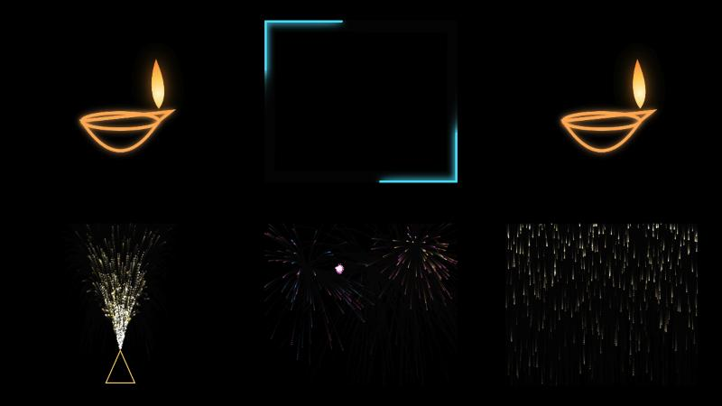

# Projection Mapper

Turn a projector and a browser into a projection-mapping rig. Drag zones onto the real
surfaces in a room (paintings, pillars, boxes, a window) and fill each one with a glowing
effect, a video, a Lottie animation or a YouTube clip.

No install, no build step, no account: it's a web page.

## Features

- **Corner-pin mapping:** drag each zone's four corners onto a surface; it warps to fit.
- **Built-in effects**, drawn live: `diya` (oil lamp), `anar` (fountain firework), `fireworks`,
  `shower` (falling glitter), `trace` (neon light running round the edges), `pulse` (colour wash),
  `grid` (for lining things up).
- **Your own content** per zone: a video file, a [Lottie](https://lottiefiles.com) `.json`
  animation, or a YouTube link.
- **Add, duplicate, copy/paste and delete zones** as you go.
- **Remembers everything** in the browser, and **exports / imports** a whole setup as a file to
  back it up or share it.
- **Works offline** (except YouTube), and over Chromecast if you don't have a cable.

## Quick start

1. [Download the ZIP](../../archive/refs/heads/main.zip) (or clone this repo) and unzip it.
2. Connect your projector as a second display (**extended**, not mirrored).
3. Start it:

   | Mac | Windows | Linux |
   |---|---|---|
   | double-click `start-mac.command` | double-click `start-windows.bat` | run `./start.sh` |

   These run a tiny local web server (needs Python 3) and open the page in your browser.
   No Python? Just open `index.html` in your browser. Everything works except YouTube zones,
   because YouTube refuses to play inside pages opened as files.
4. Drag the browser window onto the projector, click the page, and press **F** for fullscreen.

Chrome or Edge recommended. On a Mac, the first time you may need to right-click
`start-mac.command` → **Open** to get past Gatekeeper.

## Mapping your wall

1. Press **G** to show a full-screen grid, then adjust the projector's focus and keystone until it
   looks straight. Press **G** again to hide it.
2. Press **Shift+Space** for edit mode. Drag the middle of a zone to move it, drag a corner circle
   onto the matching corner of the real surface. Watch the wall, not the laptop.
3. Press **Shift+Space** again to leave edit mode. Positions are saved.
4. Press **P** to pick each zone's effect, colour, or video / Lottie / YouTube link.

Anything **black** is invisible on the wall (black is "no light"), so glowing content on a black
background looks like it's painted onto the surface. [CONTENT.md](CONTENT.md) lists free
Diwali and Halloween animations and videos that project well.

## Keys

| Key | What it does |
|---|---|
| **Shift+Space** | Edit mode on / off |
| **P** | Panel: effect, colour, video / Lottie / YouTube per zone, add zone, export / import setup |
| **G** | Full-screen alignment grid |
| **R** / **Shift+R** | Rotate the grid 15° / 1° |
| **F** | Fullscreen |
| **H** | Hide / show the help box |
| *In edit mode:* | |
| drag | Move a zone, or a corner |
| **Shift**+drag, arrow keys | Fine adjustment (**Shift**+arrows = 10 px) |
| **Alt**+drag | Rotate / scale the zone |
| **R**, **Alt**+←/→ | Rotate the zone 90°, or a little at a time |
| **]**, **[** | Bring the zone forward / send it back, for overlapping zones |
| **H**, **V** | Flip the zone's content horizontally / vertically |
| **N** | New zone |
| **⌘/Ctrl+C**, **⌘/Ctrl+V** | Copy the selected zone, paste copies of it |
| **X** | Switch the selected zone off / on |
| **Delete** | Delete the selected zone |
| **S** | Solo the selected zone (hide the others); press again to undo |
| **R**, **H**, **V** | Rotate 90°, flip horizontally, flip vertically |

## Good to know

- Video and Lottie files have to be picked again after a reload (browsers don't let pages reopen
  files on their own). YouTube links are remembered.
- YouTube clips play muted and on a loop. Some videos block embedding and won't play.
- Settings are stored per address: `file://…/index.html` and `http://localhost:8765` keep separate
  setups. Use **Export setup** / **Import setup** to move one across.
- Projecting someone else's video at a public or paid event may need their permission.

## Adding your own effect

Effects are plain functions in [`src/effects.js`](src/effects.js). Add one and it shows up in the panel's
dropdown. See [CONTRIBUTING.md](CONTRIBUTING.md).

## Credits and licence

MIT licensed, see [LICENSE](LICENSE). Built on two MIT-licensed libraries, bundled in `vendor/`:
[maptastic](https://github.com/glowbox/maptasticjs) for the corner-pin warping and
[lottie-web](https://github.com/airbnb/lottie-web) for Lottie playback. Details in
[THIRD_PARTY_NOTICES.md](THIRD_PARTY_NOTICES.md).
